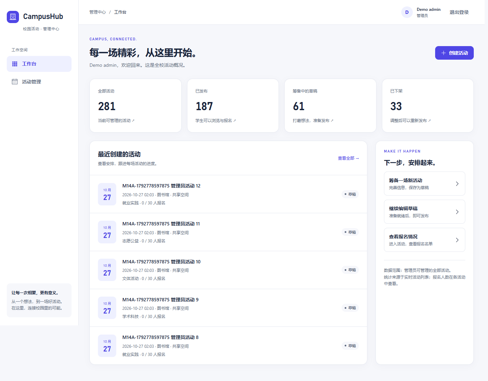
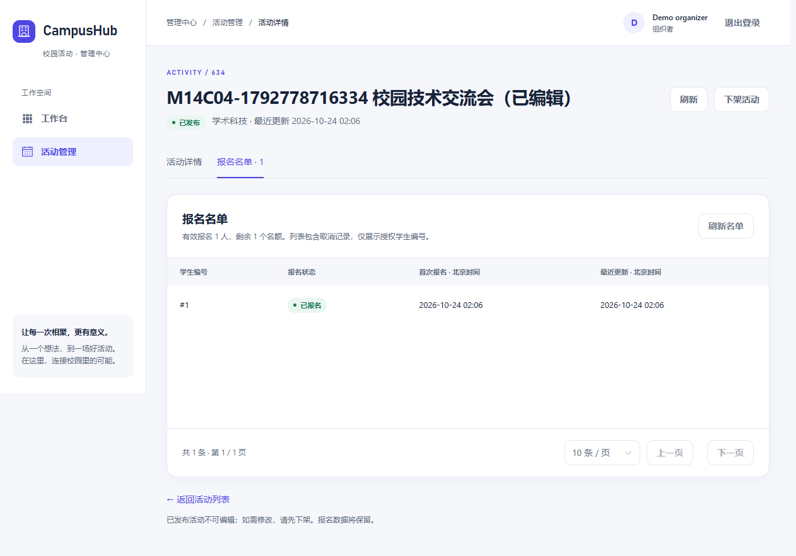
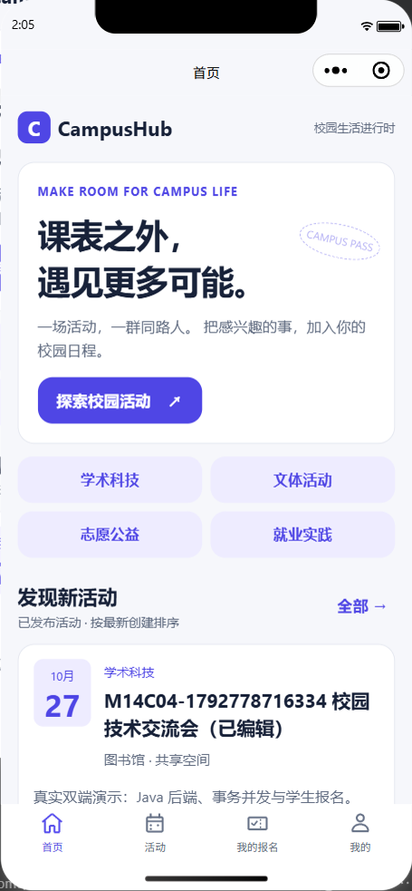
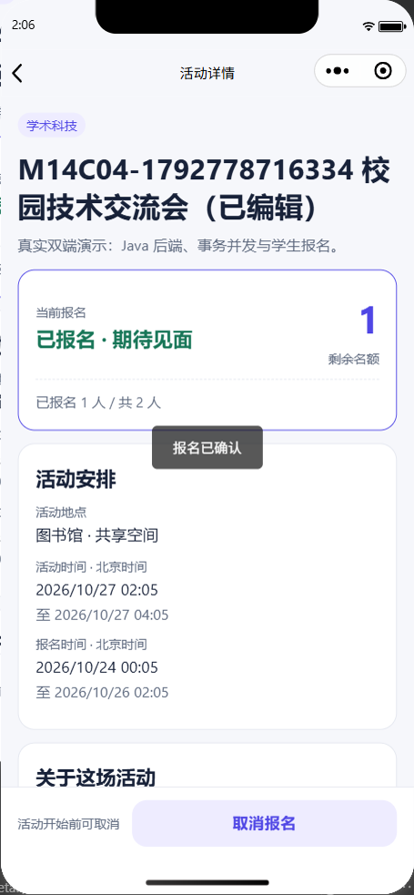
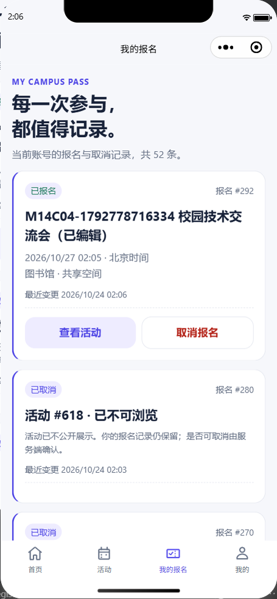
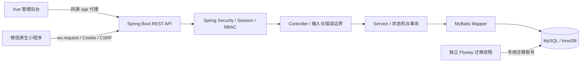
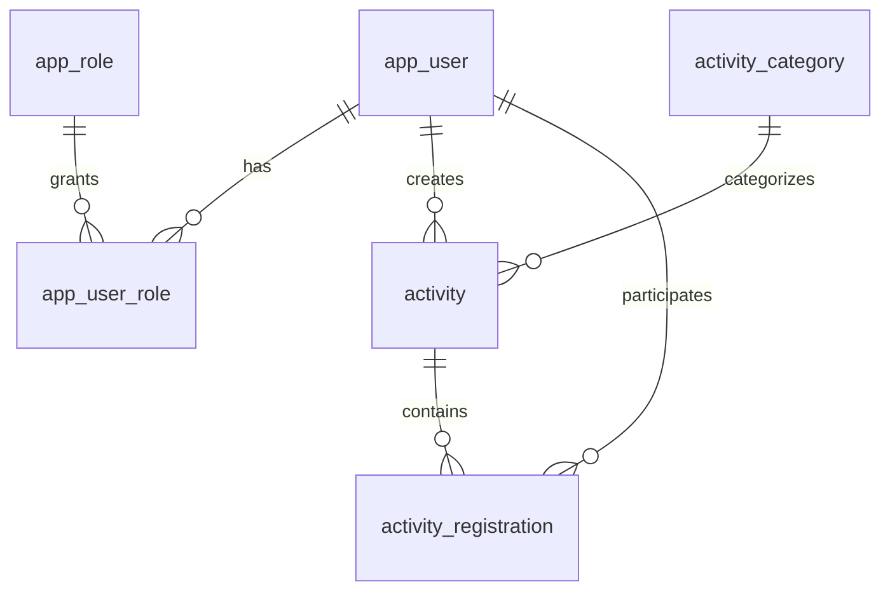

# CampusHub

面向求职展示的校园活动项目。Vue 3 管理后台与原生微信小程序共享真实 Spring Boot / MySQL 数据。v1.0.0 是已验收的本地 MVP，历史结果见 [MVP 验收](docs/verification/m1.4-c-04.md)。当前 `codex/m1-production` 分支增加正式微信身份交换、管理账号登录、撤权和生产部署适配；**尚未正式上线，真实微信链路与生产环境仍待外部资源验收**。运行和资源步骤见 [生产部署说明](docs/m1-production-deployment.md)，双端构建见 [客户端说明](docs/m1-production-clients.md)。

## 主要功能

CampusHub 将校园活动从组织者发布到学生参与串成可验证的双端流程：

| 使用者 | 已实现能力 |
|---|---|
| 学生（微信小程序） | 登录、活动分类与关键词搜索、分页浏览、详情、报名、取消、重新报名、我的报名、退出 |
| 组织者（Vue 管理后台） | 工作台、本人活动创建与编辑、发布/下架/重新发布、人数与报名名单分页 |
| 管理员（Vue 管理后台） | 管理全部活动与名单；同样遵守活动状态、版本和容量约束 |

活动浏览需要登录；未发布详情不对学生开放。当前 M1 分支不包含签到、预约、AI 推荐或消息推送。微信登录代码已经实现，但本地假上游契约测试不能替代官方微信、真机与合法域名验收。

## 双端展示

以下均为 C-04 真实 Spring Boot / MySQL 环境下的操作截图，包含测试夹具名称和演示账号；列表数量是取证时状态，不是性能指标。完整链路见 [最终验收](docs/verification/m1.4-c-04.md)。

### Vue 管理后台





### 微信原生小程序

| 活动首页 | 报名详情 | 我的报名 |
|---|---|---|
|  |  |  |

## 技术栈与系统架构

| 层次 | 技术与用途 |
|---|---|
| 后端 | Java 21、Spring Boot 4.1.1、Spring Security 7.1.1、MyBatis Starter 4.1.0、springdoc 3.1.1 |
| 数据库 | MySQL 8.4 / InnoDB、utf8mb4、显式 Flyway V1～V4 迁移 |
| 管理端 | Vue 3、TypeScript、Vite、Element Plus、Vue Router |
| 学生端 | 原生 TypeScript / WXML / WXSS、wx.request，无 npm 运行时框架 |
| 工程验证 | Maven Wrapper 3.9.16、Vitest、Playwright、Node Test、微信官方编译器与模拟器 |



后端按 `auth`、`activity`、`registration`、`category` 业务包组织，包内保持 Controller → Service → Mapper；统一错误响应，服务端决定身份和资源归属。应用启动不运行 Flyway，不持有迁移或 root 凭据；dev/test/prod 边界见 [后端运行说明](docs/backend-development.md)。

### 数据库设计



数据库通过外键、`UNIQUE(activity_id, user_id)` 和人数 CHECK 约束守住一致性。活动与报名分别维护版本号；取消与重报复用同一报名记录，避免旧取消请求影响新一次报名。UTC 时间读写、分页索引及状态约束均有实际迁移与测试，详见 [活动设计](docs/m1.2-design.md)、[报名设计](docs/m1.3-design.md) 和 [数据库权限](docs/database-permissions.md)。

### 认证、权限与报名并发

- Spring Security 校验数据库演示账号，密码以 PBKDF2 哈希保存；登录轮换 Session，写请求校验 CSRF，注销销毁会话。三角色权限和组织者资源归属由后端检查，客户端不能用 userId/role 冒充身份。
- **开发演示登录仅供本地开发与测试**：默认关闭，需要显式开关、dev/test profile 和 loopback；生产误启拒绝启动。它不是正式微信登录。当前角色权限是登录时快照，动态撤权尚未实现。
- 报名写事务使用 `READ_COMMITTED`，统一先锁活动行，再锁报名；名额与明细原子提交/回滚。独立物理连接验证最后名额竞争、跨活动首次插入、容量/下架竞争、真实约束回滚和锁超时恢复，不据此宣称吞吐量或生产承载能力。
- 两端防重复提交；小程序写入结果未知时先回读核实，旧版本不能解除未知状态锁，身份切换通过 epoch 隔离旧请求。具体边界见 [小程序说明](docs/miniprogram-development.md)。

## 从哪里开始

1. 阅读 [阶段计划](PLAN.md) 和 [当前环境](docs/environment.md)。
2. 阅读 [后端构建、测试和运行说明](docs/backend-development.md)。
3. 阅读 [管理后台运行说明](docs/admin-web-development.md)、[小程序运行说明](docs/miniprogram-development.md)、[当前交接](docs/DEV_HANDOFF.md) 和 [C-04 验收报告](docs/verification/m1.4-c-04.md)。
4. 本机安装、数据库初始化和首次迁移均已完成，不重复执行。新读者需先准备自己的隔离环境与外部凭据；仓库不提供可直接使用的密码，不宣称新电脑一键运行。

普通 PowerShell 7 终端可先预览后端操作，完整三端运行命令见下文。集成测试仅写真实测试库，部分活动/报名夹具保留；不修改 MySQL 服务或 ACL：

```powershell
Set-Location 'E:\Project\CampusHub'
& .\scripts\Invoke-Backend.ps1
```

操作脚本默认只预览，显式 `-Apply` 执行已批准操作。当前可按后端说明构建测试与启动应用；不要重跑初始化、安装和首次 baseline。安装包位于仓库外 `E:\Project\CampusHub.local\packages`。安装交接启动器的测试要求全新环境，安装完成后不要为运行它而清理现有实例。

## 目录

| 目录 | 当前内容 |
|---|---|
| `infra/mysql` | 新实例固定配置、SQL 初始化和账号授权模板 |
| `scripts` | 安装、初始化、授权及验收脚本 |
| `docs` | 环境、安装说明和验证记录 |
| `backend` | Maven Wrapper、Spring Boot 分层后端、真实 MySQL 集成测试 |
| `miniprogram` | 原生 TypeScript / WXML / WXSS 学生端、单元与模拟器测试 |
| `admin-web` | Vue 3 管理后台、设计tokens、单元与真实浏览器测试 |

日常应用仅使用业务账号；迁移是独立步骤。实际密码仅保存在仓库外受 NTFS 权限保护的目录中，不写入 Git 或命令参数。MySQL80 保持原样。

`backend/src/main/java/com/campushub` 是业务源码，`backend/src/test` 是真实数据库/HTTP测试，`infra/mysql/migrations` 是版本化 SQL；两端源码在各自的 `src/`，测试在 `tests/`（Vue 单元测试另与源码相邻）。构建产物、凭据和微信私有设置被忽略，锁文件及 Wrapper 必须提交。

## 已准备好的 Windows 环境

| 层 | 当前基线与入口 |
|---|---|
| 后端 | Java 21（脚本固定 `D:\develop\jdk`）、Spring Boot 4.1.1、Security 7.1.1、MyBatis Starter 4.1.0；Maven Wrapper 3.9.16 |
| 数据 | MySQL 8.4.11，服务 `MySQL84CampusHub`，TCP `127.0.0.1:3307`；演示和测试使用 `campushub_test` |
| 管理端 | Vue 3、TypeScript、Vite、Element Plus；Node.js 22.12+，本机已验证 Node 24.22.1 / npm 12.2.0 |
| 学生端 | 微信原生 TypeScript / WXML / WXSS；官方开发者工具 2.02.2608080，本地测试号 |
| 命令环境 | PowerShell 7；脚本保留5.1语法兼容，不绕过系统执行策略 |

本说明验证范围是本机已准备好的环境，不宣称全新电脑一键安装通过。JDK、Node、微信工具及数据库受限凭据须预先具备；不要复制本机 secrets 到仓库或交付包。新机器配置需按环境文档单独准备，不可重跑本机安装/初始化入口。

Windows Wrapper 通过已有 `pwsh.exe` 调用 PowerShell 7，保留本机 JDK 基线；项目脚本固定 JDK、实例名、3307 和仓库外 runtime 路径作为保护条件，不能仅改连接字符串就指向任意数据库。配置入口：[`mysql84.psd1`](infra/mysql/mysql84.psd1)、[`application.yml`](backend/src/main/resources/application.yml)、[账号 SQL 模板](infra/mysql/sql/02-create-accounts.sql.template)。模板只有占位符，`CH_DB_PASSWORD` 由启动器注入，不自动读取 `.env`。新环境适配需独立核验这些边界，不应关闭保护或复用本机私有文件。

## 三端本地演示

所有命令从 `E:\Project\CampusHub` 执行。先用 `Get-Service MySQL84CampusHub` 确认 Running；若为 Stopped，在标准管理员 PowerShell 中执行 `Start-Service -Name MySQL84CampusHub`，不要操作 MySQL80。用 `Get-NetTCPConnection -State Listen -LocalPort 3307` 检查监听。

```powershell
Set-Location 'E:\Project\CampusHub'
# 首次准备依赖；只改前端时无需重复后端全量回归
npm.cmd --prefix admin-web ci
npm.cmd --prefix miniprogram ci
pwsh -NoProfile -File scripts/Invoke-Backend.ps1 -Action Verify -Apply
npm.cmd --prefix miniprogram run build
# 终端一：固定test库，8080占用会拒绝
pwsh -NoProfile -File scripts/Invoke-AdminTestBackend.ps1 -Apply
```

终端二运行 `npm.cmd --prefix admin-web run dev`，打开 [管理中心](http://127.0.0.1:5173)。微信工具导入 `E:\Project\CampusHub\miniprogram` 后实际点击“编译”，代码目录为 `dist/`。修改学生端源码后先 build，再重新编译；具体测试号及本地合法域名设置见 [小程序运行说明](docs/miniprogram-development.md)。

Vue 使用 `demo_organizer`，小程序使用 `demo_student`；密码由本机授权开发者私下查看 `E:\CampusHubRuntime\mysql84\secrets\campushub_test-demo.json`，不放进命令、截图、日志或聊天。启动器自动读取独立 test-app 凭据，业务进程没有迁移/root凭据。演示账号不能当作正式微信身份；公开配置保留域名检查，本机豁免仅限模拟器。

`project.config.json` 中现有 AppID 是开发工具测试号标识，不是 AppSecret；其他开发者应使用自己的官方测试号。私有本地设置被忽略，当前学生端仅允许模拟器访问本地 API。

**演示顺序：** Vue 创建新活动（使用未来报名/活动时间）→ 编辑 → 发布 → 微信搜索标题 → 详情报名 → 我的报名 → Vue 名单/人数 → 微信取消 → Vue 刷新名单 → 微信重报 → Vue 下架 → 微信搜索/详情不可浏览 → Vue 重新发布 → 双端核对原报名及人数。旧验收夹具报名窗口会到期，每次演示新建活动，不删除历史夹具。5～8分钟的讲解顺序见 [面试演示](docs/interview-notes.md)。

**结束演示：** 分别在 Vite 和后端常驻终端按 Ctrl+C。退出本轮微信开发者工具（或使用其关闭项目/退出入口），释放9420自动化端口；不要停止数据库服务。检查 `Get-NetTCPConnection -State Listen -ErrorAction SilentlyContinue | Where-Object LocalPort -in 8080,5173,9420`；若仍有监听，先核对进程与路径，只结束本轮启动的进程，不能按所有Java/Node进程批量停止。

## 测试、证据与边界

以下是 **C-04 最终验收时的实际结果**，本轮 GitHub 预审仅做交付定向检查，没有重新运行整套测试：

| 项目 | 最终验收结果 |
|---|---|
| 后端 Maven verify | 70 执行项，0 失败/错误/跳过，含真实 MySQL/HTTP 与独立连接并发 |
| Vue | 12 单测、8 真实 Edge E2E；类型、ESLint、格式、构建通过 |
| 微信小程序 | 23 单测、18 真实 HTTP 客户端用例；8 WXML / 10 WXSS 官方编译通过 |
| 真实双端 | 创建/编辑/发布/报名/名单/取消/重报/下架/重发布闭环通过 |
| 异常与数据 | 原生提交前断网/恢复、浏览器自然闲置过期；最终 SQL 人数不一致/超额/重复/孤儿均为 0 |
| 依赖审计（验收时） | Vue 全部与两端运行时均为 0；小程序开发自动化链仍 5 项 moderate，关联 phin |

后端完整命令及 Flyway validate 见 [后端说明](docs/backend-development.md)；Vue 类型/ESLint/单测/构建/实际浏览器E2E见 [管理端说明](docs/admin-web-development.md)；小程序类型/静态检查/单测/官方编译器/模拟器见 [学生端说明](docs/miniprogram-development.md)。运行真实UI测试前必须启动test后端及对应客户端，禁止把E2E指向开发库。

最终矩阵、SQL一致性、截图和未执行范围统一在 [C-04验收](docs/verification/m1.4-c-04.md)。测试脚本会保留带前缀的夹具；旧阶段测试脚本仍写固定历史报告名，重跑前先备份对应证据，完成后将新结果归档到当期目录并恢复历史文件，不能把旧截图当作本轮结果。

## 已知限制与后续计划

- 已完成真实 Vue 和微信模拟器双端本地 MVP 验收；尚未正式部署、接入正式微信登录或微信发布。
- 真机、部分原生网络边界（长超时、服务端提交后才断网）、Firefox/Safari、屏幕阅读器和全新电脑安装仍为 NOT_RUN。Node 传输层的丢响应测试不替代原生网络验证。
- 保留小程序开发链 5 项 moderate，不强制降级；后续替换自动化链需重新验证模拟器兼容性。审计数字仅反映最终验收时的快照。
- 后续可独立评估动态撤权、正式身份接入、HTTPS/合法域名、部署与运维方案；这些不是已实现能力，也未在本轮启动。

## 公开交付与许可

[GitHub 最终确认与首次提交清单](docs/verification/github-final-confirmation.md)（[G01历史预审](docs/verification/github-preflight.md)） 说明交付文件、安全检查、历史证据隐私边界及首次提交建议。首次 GitHub 源码交付过程与结果见 [v1.0.0 发布记录](docs/verification/github-v1.0.0-release.md)；后端部署与微信正式发布不在本次交付范围。

CampusHub 自有代码和文档采用 [MIT License](LICENSE.md)，版权署名为 2026 Acecc228。Maven Wrapper 保留 Apache-2.0 声明及许可证副本；第三方依赖与素材说明见 [THIRD_PARTY_NOTICES.md](THIRD_PARTY_NOTICES.md)。
